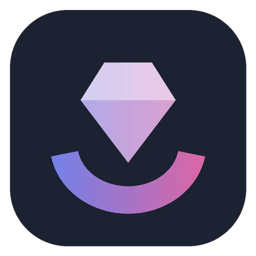
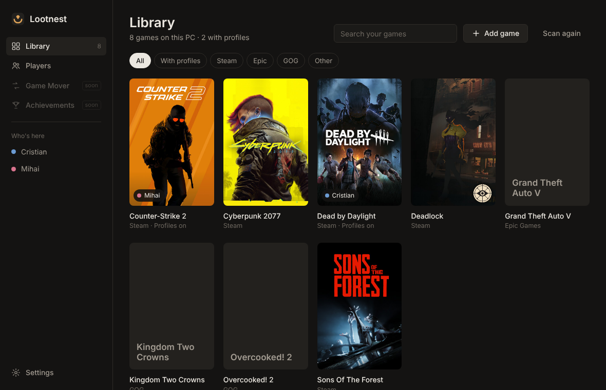
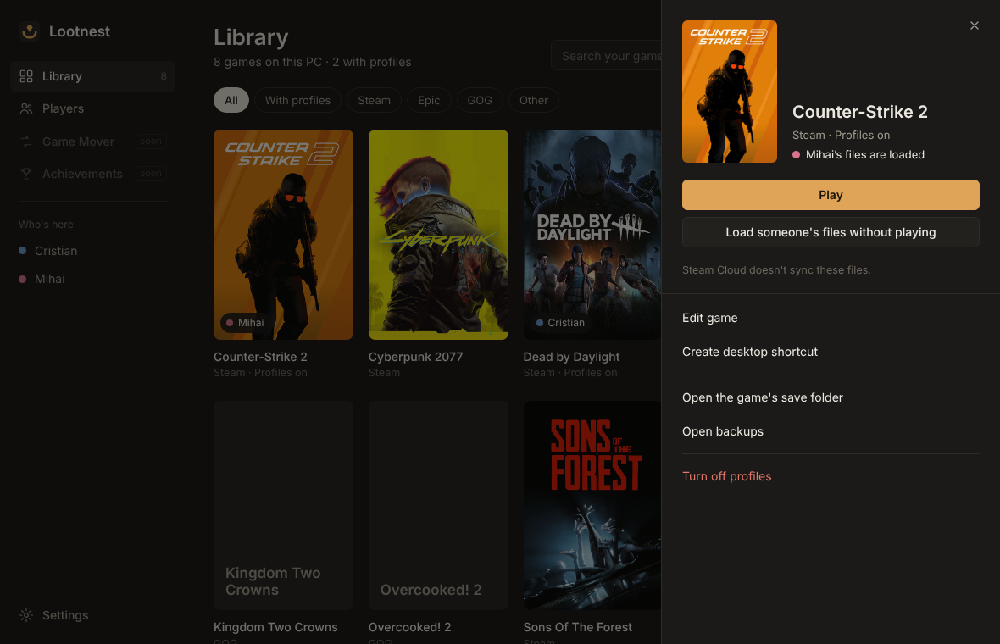
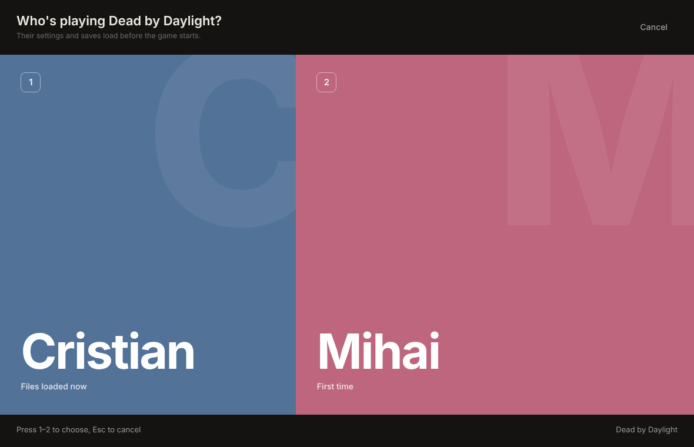

<p align="center"></p>

<h1 align="center">Lootnest</h1>

<p align="center">A free, open-source game manager for Windows.<br>Every game on your PC in one place, and the tools around them: save copies, runs, profiles, save points and achievements.</p>

<p align="center"><b>In beta.</b> Everything that moves your files makes a copy first.</p>

<p align="center"><a href="../../releases/latest"><b>Download for Windows</b></a>&nbsp;&nbsp;&nbsp;<a href="https://c-dinca.github.io/lootnest/">Website</a>&nbsp;&nbsp;&nbsp;<a href="CHANGELOG.md">What's new</a></p>

---



Lootnest finds the games on your PC (Steam, Epic, GOG and the rest) and puts them in one library. For the games you share, turn on **profiles**: press **Play**, pick who's playing, and Lootnest puts that person's resolution, sensitivity, keybinds and saves in place before the game starts. When the game closes, their progress goes back to their own profile.

It starts with one profile: yours, named after your Windows account. Keep **runs** of a game, such as a hardcore try or a new game+, each with its own saves and settings, and switch between them from the game's page. Games from outside the stores get a safety net: their saves are copied whenever they change.

Sharing the PC? Add a profile for each person (Profiles, or **Add someone else** on the first start). Then **Play** asks who's playing, and nobody overwrites anyone else's settings, even on one Windows account and one Steam account.

## Why I made this

I'm one person, a software engineer who plays a lot of games, and Lootnest is my personal project. My games were spread over half a dozen launchers and folders, my saves lived wherever each game felt like putting them, and one bad sync or a second playthrough could cost me a hundred hours. I wanted one place for all of it.

Lootnest isn't trying to replace Steam, Epic, GOG or any store. You keep buying and installing games where you always have. Lootnest sits next to them: every game in one place, with the tools I kept wishing I had around them.

I build it with Claude as a coding partner. It isn't vibe coded: I design it, I read the changes, every change that touches your files copies them first, and nothing ships until the tests pass on Windows itself.

It's free, for everyone, and it stays free. No account, no ads, no telemetry, and it works offline.

> **Lootnest was called PlaySwap** until version 1.3. Installing Lootnest over PlaySwap carries over players, games, profiles, backups and the Steam set-up.

## Features

**Library**
- Every game in the sidebar, as in Steam's library: what's playing, the last played, your collections and all of them, with a filter. Fold the sidebar to a rail of icons (Ctrl+B) or drag it wider. The Library itself shows covers in three sizes or a list.
- Every game on the PC in one grid, with search and a filter for each store: Steam, Epic, GOG, Xbox and PC Game Pass, EA app, Ubisoft Connect, Battle.net, Riot, Amazon Games, Rockstar, itch.io, Hydra, game folders on every drive, and your shortcuts. Games a launcher must start (Ubisoft, Battle.net, Xbox, Amazon, Epic) start through it, like from the launcher.
- Covers come from Steam's own cache on your PC. For the rest, turn on **Download covers and artwork**: covers, wide art and logos from the Steam store, and from SteamGridDB for any other game if you add your free API key.
- **Home** opens on the game you played last, in its own artwork, with a Play button for each player, then **Continue playing** with the other recent games and **News from your games**. The **Library** has all your games.
- The window takes on the colours of the game you choose. Sort by name, recently played or most played, pick the cover size, and right-click a game for everything you can do with it. Ctrl+F finds a game.
- Lootnest counts how long each player has played each game, shown on the game's page in the players' colours.
- Every game has its own page: its art, who has a profile, whose files are loaded, and everything else about it. Rename it, add launch options, open its folder, put a shortcut on the desktop, or have Steam check its files. None of this needs profiles.
- Games without a cover show their own icon, read from the game on your PC.
- **Store**, if you turn it on: today's deal, the deals and top sellers on Steam, and the best deals on well-reviewed games in other official stores. The **Search** box at the top of the sidebar (Ctrl+K) finds your games and, with the Store on, any game, from every page. Look up any game, installed or not. Its page shows its price on Steam and in other official stores (from CheapShark, which lists authorized stores only), the lowest price it has had, whether it runs on this PC (great, well, on low settings, may struggle, or probably not) with a bar for the graphics card and the processor against the minimum and recommended requirements, those requirements beside your PC's own parts, and a link to its PCGamingWiki page. **Open** takes you to the store in your browser; a game already on your PC opens in the Library.
- **Updates**, for games no store keeps up to date (in a folder, added by hand, or from Hydra): the page lists which have a newer version out, from Steam's patch notes, and **Apply an update** takes an update you have: a folder, a .zip, .7z or .rar (multi-part too), or an installer it runs and watches. It checks the update's version against your copy's and warns when one would be skipped, and updates come off again one at a time. When a game is reinstalled as a whole new version (in a new folder, or over the old one), Lootnest asks whether it's a new copy and carries everything over: the saves kept inside its folder, its profiles, playtime, status, collections and settings. The old folder can then be deleted, with its saves copied first. Lootnest shows what it will replace and add, copies the saves and every file it replaces first, checks each new file, and **Undo** puts the game back as it was. If the game closes right after its first start since an update, Lootnest says so and offers Undo. Lootnest doesn't download updates.
- **Year in games**, on each profile's page: a picture of your year (hours, days, your most played games, each month), saved in Pictures to share. Made on your PC; nothing is sent.
- **Tonight**, on Home: one game to play next, from your Up next, what you're playing and what you never started, with **Another** to spin again.
- **Big Picture**: the whole screen, like a console, for a controller (Start, F11, or the tray): rows of games, a screen for each with Play and Play as someone else, and Who's here.
- **Your saves, on Home**: how Lootnest looks after each game's saves, and which games it can't find saves for yet.
- **Copies of every game's saves**: for games outside Steam, Lootnest copies the saves it knows of (in Documents, AppData or the game's own folder) whenever they change and the game is closed, and keeps the last five on this PC. Put one back from the game's page.
- **Save points**: a named copy of a game's saves ("Before the boss") from its page, or with Ctrl+Shift+F5 while you play. Go back to any of them, with the saves as they are now kept first, or start a new run of a profile from that moment.
- **Keep a game offline**: one click has Windows Firewall stop a game Lootnest starts from connecting, and one click lets it online again. Windows asks first.
- **Achievement check**: for a game from outside the stores, **Check why** goes through why its achievements don't show (its Steam id, the tool next to it, the file it keeps, the names), and can set the name the game shows to your profile's.
- **Achievements as they unlock**: for games whose achievements a Steam-compatible tool keeps on this PC, a small note shows over the game when one unlocks, with how rare it is and the playing profile's colour. It's Lootnest's own window, never anything in the game, and never for games with an anti-cheat.
- **Updates and news**, if you turn it on: each game's page lists its latest updates and patch notes from Steam's news feed. For a game no store keeps up to date, Lootnest says when a newer version than yours is out.

**Profiles and runs**, per game, when you want them
- One profile to start with. **New run** on a game's page starts another playthrough with its own saves and settings, from nothing or from a copy of yours.
- **Try a save** from a friend or a mod site in a run of its own: your settings with their save, and your own saves untouched.
- Add a profile for everyone who shares the PC: each gets their own settings and saves, on one Windows account and one Steam account.
- Works with any game that keeps its settings and saves in files. Lootnest finds where most games keep them.
- Steam's own Play button can ask "Who's playing?" too, after a one-time automatic setup.
- Desktop shortcuts that ask every time.

**Safe by design**
- A backup before every swap, no half-written files, and folders too broad to swap are refused.
- **Steam Cloud can stay on.** Each game says whether Steam Cloud syncs its swapped files. If Steam ever replaces a player's files with the cloud's copy, Lootnest says so and keeps that player's profile as it was.
- **Anti-cheat friendly.** It never injects into, hooks or reads the memory of a game. With FACEIT AC, one click switches a game to being started by Steam (see [below](#anti-cheats-faceit-ac)).

**Game Mover**
- Move a Steam game to another of your Steam libraries, such as a bigger or faster drive, from its panel. The game is copied and checked before anything is removed, and Steam is closed and reopened for you.

**Stays out of the way**
- Lives in the tray and notices games started outside Lootnest.
- Keeps itself up to date if you let it (it asks once): a notification when a new version is out, installed while Lootnest is in the tray and no game is running. Or **Settings > Check for updates**, then **Update now**.

**Coming next:** a panel over the game with the seated profile's achievements, Lootnest on a USB stick that brings your profiles to a friend's PC, and Game Mover for games outside Steam.



## Install

1. Download `Lootnest-Setup.exe` from the [latest release](../../releases/latest) and run it.
2. If SmartScreen says it protected your PC, choose **More info**, then **Run anyway**. You may see this until releases are signed (see [Code signing policy](#code-signing-policy)).
3. Name the players. The Library fills itself; turn on profiles for the games you share.

You need Windows 10 or 11 (64-bit) with the Microsoft Edge WebView2 Runtime, which comes with Windows 11 and current Windows 10. No administrator rights are needed.

To update, use **Settings > Check for updates**. Your players, games and profiles are kept. To uninstall, use Windows **Settings > Apps > Installed apps**.

To install without a window, for scripts and package managers, run `start /wait Lootnest-Setup.exe --silent` in Command Prompt, or `Start-Process Lootnest-Setup.exe --silent -Wait` in PowerShell (`/S` and `/silent` work too). It installs for your Windows account with a Start menu shortcut; on an upgrade the desktop shortcut and Start with Windows stay as they are, and a first install adds neither. It doesn't open Lootnest afterwards. It exits with 0 when Lootnest is installed and 1 when it couldn't be, and then writes the reason to `Lootnest-Setup.log` in your `%TEMP%` folder.

## Code signing policy

Free code signing provided by [SignPath.io](https://about.signpath.io), certificate by [SignPath Foundation](https://signpath.org).

- Committers and reviewers: [Cristian Dinca](https://github.com/c-dinca), the repository's owner
- Approvers: [Cristian Dinca](https://github.com/c-dinca)

Every signed release is built by GitHub Actions from this repository's source ([build.yml](.github/workflows/build.yml)); nothing built anywhere else is signed. Privacy: Lootnest sends nothing unless you turn a feature on that needs to go online; see [Privacy](#privacy).

## Security

How Lootnest protects your files, its window and its updates is in [SECURITY.md](SECURITY.md), along with how to report a problem privately.

## Privacy

No account and no telemetry; Lootnest works offline. It only goes online when you ask it to:

| What | When | What is sent |
| --- | --- | --- |
| **Check for updates** | When you press it, or every 6 hours if **Check for updates automatically** is on (off until you answer "Keep Lootnest up to date?") | A request for the latest Lootnest version, to `api.github.com` |
| **Update now** | When you press it | Downloads the installer from the GitHub release, and checks its SHA-256 before running it |
| **Download covers and artwork** | Only if you turn it on (off by default) | The game's name, to `store.steampowered.com`; covers, wide art and logos come from Steam's image server and are saved on your PC |
| **SteamGridDB API key** (optional, in Settings) | With covers on, for games the Steam store doesn't know | The game's name or Steam id and your key, to `www.steamgriddb.com`; images come from its CDN and are saved on your PC |
| **Steam Web API key** (optional, in Settings) | When you open a game's page and its achievements on this PC have no names (a game in a folder, or Steam's partial list); each game's list is kept for a week | The game's Steam app id and your key, to `api.steampowered.com`; the names, descriptions and picture links are saved on your PC |
| **How rare achievements are** (Settings, Online) | Only if you turn it on (off by default), when a game's achievements are shown or one unlocks; each game's numbers are kept for three days | The game's Steam app id, to `api.steampowered.com` (Steam's public global percentages; no key) |
| **Show game updates and news** | Only if you turn it on (off by default), when you open a game's page; each feed is read at most every 6 hours | The game's Steam app id to `api.steampowered.com` (for a game outside Steam, first its name to `store.steampowered.com`); an update's pictures load from Steam's image server when you open it |
| **Store** (Settings, Online) | Only if you turn it on (off by default), when you open the Store page, search in it or in the sidebar, or open a game there | What you type, to `store.steampowered.com` (with the country Windows is set to, for prices in your currency); a game's Steam id, to `store.steampowered.com` and `www.cheapshark.com`. Your PC's processor, graphics card and memory are read on your PC and never sent |
| **Find save locations online** (Settings, Online, or Cloud saves) | Only if you turn it on (off by default), then about once a week | Nothing about you or your games: Lootnest downloads the Ludusavi project's list of where games keep their saves (from PCGamingWiki) from `raw.githubusercontent.com` and keeps it on your PC |

**Cloud saves and backup** never go online themselves: Lootnest writes the backup file to the folder you choose. If that folder is one OneDrive, Google Drive or Dropbox syncs, that app uploads it, under that app's own terms. With a password, the file is encrypted on your PC first (AES-256-GCM), so the cloud only ever has the encrypted file.

## How profiles work



1. You start a game from the Library, from Steam, or from a Lootnest desktop shortcut.
2. Lootnest asks who's playing.
3. It saves the files currently on the PC back to whoever they belong to, backs them up, and copies in the chosen player's files.
4. The game starts. Lootnest watches its process.
5. When the game closes, Lootnest saves the files to that player's profile.

For Steam's Play button, Lootnest sets the game's launch options to `"…\Lootnest.exe" --steam <app id> -- %command%`. It edits Steam's `localconfig.vdf` only while Steam is closed, changes only `LaunchOptions`, and keeps a backup. Options you already had are kept, and they're put back when you turn profiles off or uninstall Lootnest.

### Anti-cheats (FACEIT AC)

Some anti-cheats only let Steam start the game, so with FACEIT AC running, CS2 can't start through Lootnest's launch option. When that happens, Lootnest offers **Fix it and start the game**. It switches the game to **Let Steam start this game** (also in **Edit game**), takes itself out of the launch options, and starts the game for the chosen player through Steam.

From then on, start the game from Lootnest or from the **<game> (Lootnest)** desktop shortcut, and both ask who's playing. Steam's own Play button can't ask for these games, so if you use it anyway, a notification says whose settings are loaded.

### What profiles can't separate

Lootnest swaps files on your PC. Anything that belongs to the Steam account stays shared: achievements, playtime, friends, inventory and online ranks. So do settings a game keeps in the Windows registry or on its own servers. If everyone can have their own Steam account, that separates everything; profiles are for when you share one.

## Adding a game by hand

If the scan misses a game, use **Add game** and choose the Steam game or the .exe. Lootnest fills in the save locations it finds: with **Find save locations online** on, first the ones PCGamingWiki lists for the game, then folders named like it. Add any others yourself. [PCGamingWiki](https://www.pcgamingwiki.com) lists them for most PC games, in the "Game data" section. Paths can use `%APPDATA%`, `%LOCALAPPDATA%`, `{LOCALLOW}`, `{DOCUMENTS}`, `{SAVEDGAMES}`, `{STEAM}` and `{STEAMUSER}`.

Data lives in `%LOCALAPPDATA%\Lootnest`:
- `profiles\<player>\<game>`
- `backups\<game>\<date-time>`
- `covers`
- `avatars` and `banners` (pictures for player profiles)
- `shelf.json` and `activity.json` (each player's shelf and time played per day)
- `backup.json` (when the last backup to your folder was made)
- `sync.json` (what each player's cloud saves were at the last sync)
- `gamesaves.json` and `savedb.json.gz` (cloud saves of games outside Steam, and the save locations list)
- `safety-net\` and `safetynet.json` (copies of saves games keep inside their own folder, the last 5 per game)
- `config.json`
- `lootnest.log`

## Building from source

You need Go (go.mod's `toolchain` line names the release; recent Go downloads it by itself), Python 3 and bash (Git Bash on Windows). Pillow is optional; it only redraws the icon.

```bash
./build.sh                 # dist/Lootnest-Setup.exe and dist/Lootnest.exe
./build.sh app             # only dist/Lootnest.exe
./build.sh setup           # only dist/Lootnest-Setup.exe, from the dist/Lootnest.exe already there
VERSION=1.4.0 ./build.sh   # stamps a version (default: the VERSION file)
go test ./internal/core/   # tests
```

It cross-compiles from Windows, macOS or Linux with no C compiler. To release, bump `VERSION`, rename `## Unreleased` in CHANGELOG.md to the new version, and merge to `main`: GitHub Actions builds both .exe files and publishes the release with that section as its notes. Pushing a `v*` tag publishes one too. Signing and winget are switched off until they're set up; [docs/RELEASING.md](docs/RELEASING.md) has the steps.

| Folder | Contents |
| --- | --- |
| `internal/core` | Swap engine, path safety, Steam, Steam Cloud, Game Mover, covers, updates, game scanning (platform-neutral, tested) |
| `internal/win` | Windows calls: tray, file dialogs, shortcuts, registry |
| `internal/app` | The app; its interface is plain HTML, CSS and JS in `internal/app/ui` |
| `cmd/lootnest`, `cmd/setup` | The app and installer entry points |
| `tools` | Icon, Windows resources (icon, manifest, version), exe checks |
| `third_party` | Vendored, lightly patched go-webview2, go-winloader and golang.org/x/sys |

## Contributing

Bug reports and pull requests are welcome; see [CONTRIBUTING.md](CONTRIBUTING.md). The most useful small contribution is a **game preset**: a game's process name and settings and save locations, added to `KnownSteamGames` in `internal/core/steam.go`.

## License

[MIT](LICENSE). Third-party licenses are in [assets/THIRD_PARTY_NOTICES.txt](assets/THIRD_PARTY_NOTICES.txt).

The interface sounds are Kenney's [Interface Sounds](https://opengameart.org/content/interface-sounds) ([kenney.nl](https://www.kenney.nl)), released under CC0.
