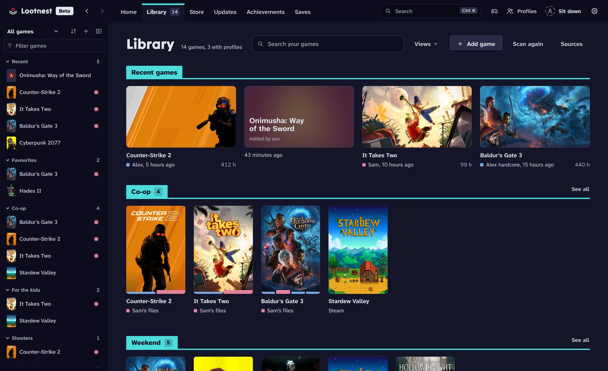
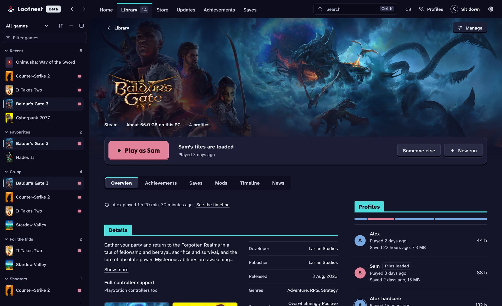
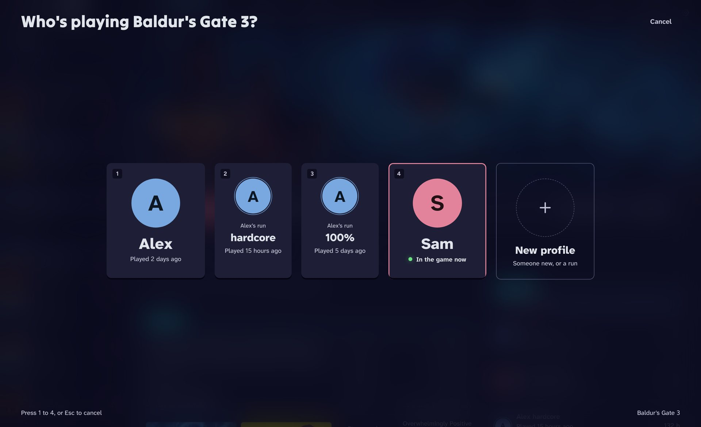

<p align="center"></p>

<h1 align="center">Lootnest</h1>

<p align="center"><b>Save slots for every game on your PC.</b><br>Every launcher in one library, and your own saves for every run and everyone who plays.</p>

<p align="center"><a href="../../releases/latest/download/Lootnest-Setup.exe"><b>Download for Windows</b></a>&nbsp;&nbsp;&nbsp;<a href="https://c-dinca.github.io/lootnest/">Website</a>&nbsp;&nbsp;&nbsp;<a href="CHANGELOG.md">What's new</a></p>

<p align="center">Free and open source. 14 MB. No account. Windows 10 and 11. In beta.</p>



## What it does

- **One library.** Steam, Epic, GOG, Xbox, EA, Ubisoft, Battle.net, Riot, Amazon, Rockstar, itch.io, Hydra, game folders and shortcuts.
- **Save slots.** Press Play, pick who's playing, and that profile's saves and settings go in before the game starts. They go back to the profile when it closes.
- **Runs.** A hardcore try or a new game+ next to your main save, each with its own saves, settings and achievements.
- **A copy first.** Every swap, update, mod and move copies your files before it changes anything, and most of it has Undo.
- **Games from outside the stores.** Saves copied whenever they change, save points with <kbd>Ctrl</kbd>+<kbd>Shift</kbd>+<kbd>F5</kbd>, achievements as they unlock.
- **Big Picture.** The whole screen, for a controller.
- **Your own cloud.** Cloud saves through your OneDrive or Google Drive folder, encrypted if you like.



## Also in it

| | |
| --- | --- |
| **Store** | Prices from Steam and other official stores, and whether a game runs on this PC |
| **Updates** | Newer versions for games no launcher updates; apply one you have, with Undo |
| **itch.io and GOG** | Install and update the games you own, after you connect your account |
| **Mods** | Add, order and apply mods per profile; put the game back in one click |
| **Plugins** | Data-only plugins for more game sources, save locations and themes |
| **Playnite** | Bring in time played, statuses, ratings and favourites |
| **Timeline** | Sessions, save points, unlocks and your captures for each game |
| **Year in games** | A picture of your year, per profile, made on your PC |
| **Keep a game offline** | A Windows Firewall rule for a game, on and off in one click |

## Who's playing



One profile to start with: yours. Add a run when you want a second playthrough, or a profile for everyone who shares the PC. Nobody overwrites anyone else's saves, even on one Windows account and one Steam account.

[How profiles work](docs/GUIDE.md), what they can't separate, and the rest of the details are in the guide.

## Install

1. Download [Lootnest-Setup.exe](../../releases/latest/download/Lootnest-Setup.exe) and run it.
2. If SmartScreen stops it, choose **More info**, then **Run anyway**. Releases aren't signed yet (see [Code signing policy](#code-signing-policy)).
3. Your games show up in the Library on their own.

Needs Windows 10 or 11 (64-bit) with the WebView2 Runtime, which Windows already has. No administrator rights.

## What it won't do

- No account, ads or telemetry. It works offline.
- It never injects into a game, hooks it or reads its memory.
- It never bypasses DRM.
- It never downloads games, except ones you own from itch.io or GOG, through their own API, after you connect them.

## Privacy

Nothing goes online unless you turn on a feature that needs it. Every one of them, what it sends and where, is listed in [docs/PRIVACY.md](docs/PRIVACY.md).

## Code signing policy

Free code signing provided by [SignPath.io](https://about.signpath.io), certificate by [SignPath Foundation](https://signpath.org).

- Committers and reviewers: [c-dinca](https://github.com/c-dinca), the repository's owner
- Approvers: [c-dinca](https://github.com/c-dinca)

Every signed release is built by GitHub Actions from this repository's source ([build.yml](.github/workflows/build.yml)); nothing built anywhere else is signed. Privacy: Lootnest sends nothing unless you turn on a feature that needs to go online; see [Privacy](#privacy).

## Building from source

You need Go (go.mod's `toolchain` line names the release), Python 3 and bash (Git Bash on Windows). It cross-compiles from Windows, macOS or Linux with no C compiler.

```bash
./build.sh                 # dist/Lootnest-Setup.exe and dist/Lootnest.exe
go test ./internal/core/   # tests
```

| Folder | Contents |
| --- | --- |
| `internal/core` | The swap engine, scanning, saves, achievements, updates (platform-neutral, tested) |
| `internal/win` | Windows calls |
| `internal/app` | The app; its interface is plain HTML, CSS and JS in `internal/app/ui` |
| `cmd/lootnest`, `cmd/setup` | The app and the installer |
| `site` | The website |

Releases: [docs/RELEASING.md](docs/RELEASING.md). Testing on a real PC: [docs/TESTING.md](docs/TESTING.md).

## Contributing

Bug reports and pull requests are welcome; see [CONTRIBUTING.md](CONTRIBUTING.md). How Lootnest protects your files and how to report a problem privately: [SECURITY.md](SECURITY.md).

Made by one person, with Claude as a coding partner. Every change that touches your files copies them first, and nothing ships until the tests pass on Windows.

## License

[MIT](LICENSE). Third-party licenses are in [assets/THIRD_PARTY_NOTICES.txt](assets/THIRD_PARTY_NOTICES.txt). The interface sounds are Kenney's [Interface Sounds](https://opengameart.org/content/interface-sounds), released under CC0.
