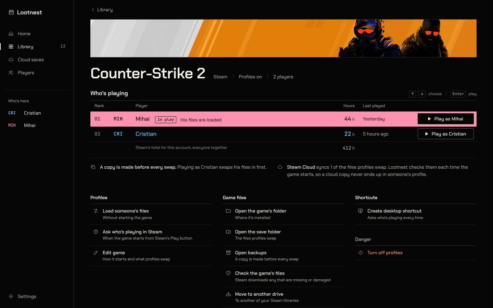
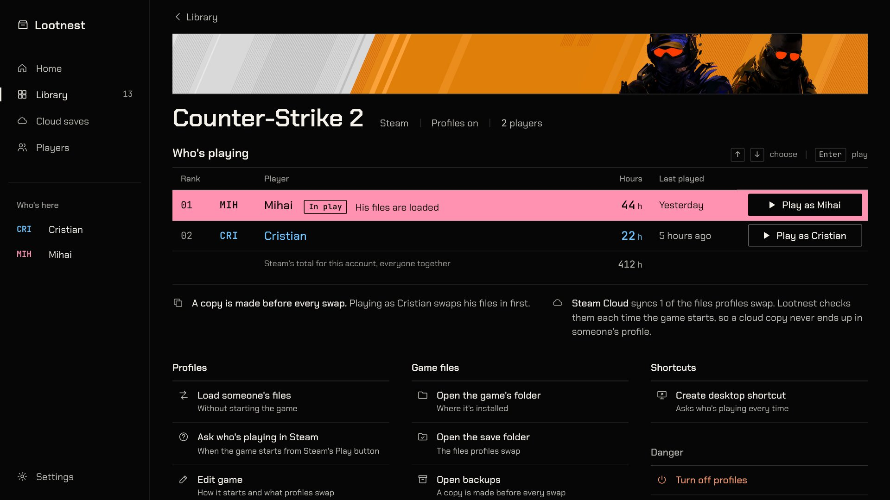
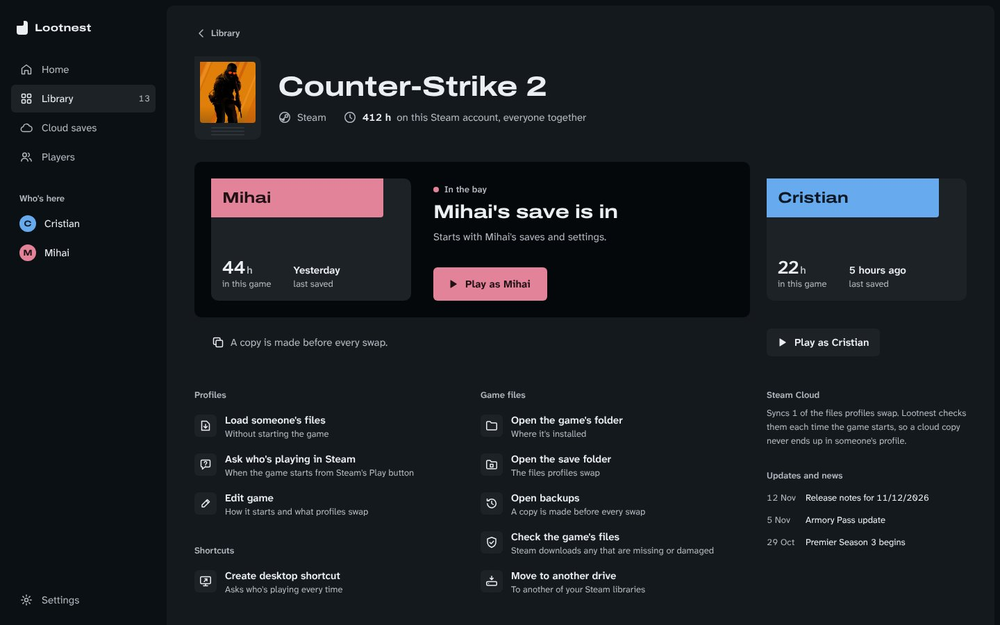
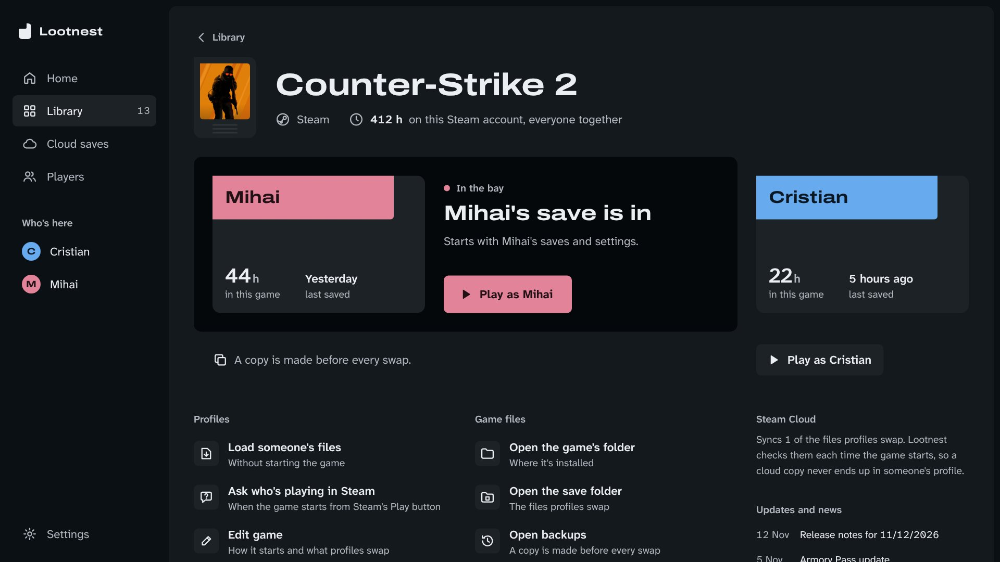
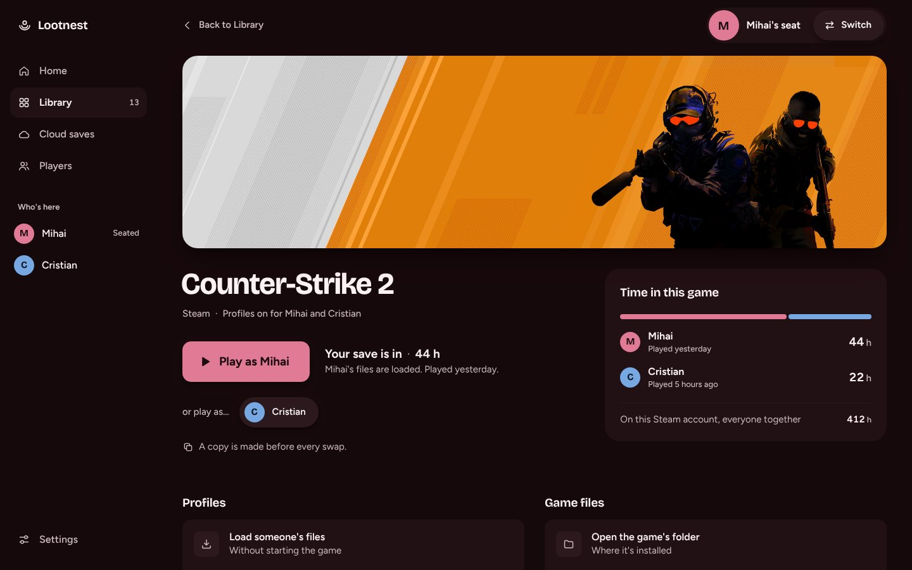
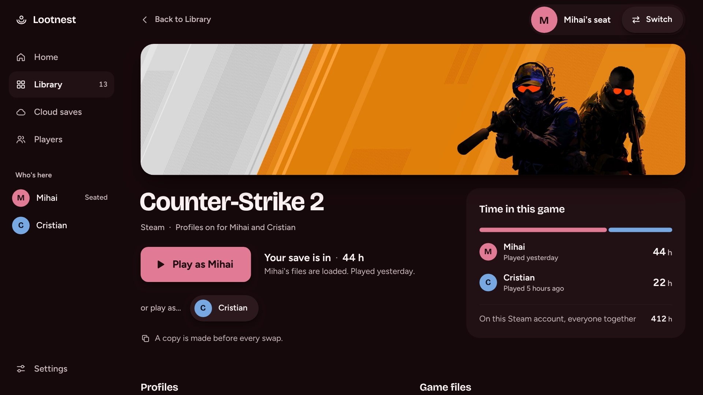
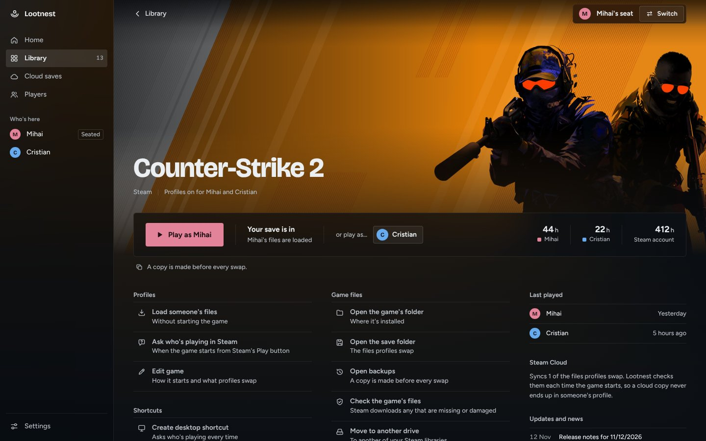
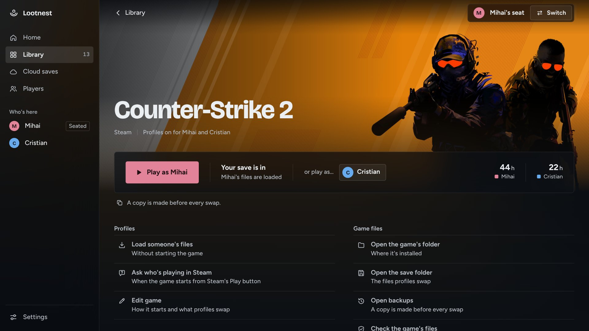

# Lootnest: three directions (Step 2)

Each direction replaces the current look. None of them polishes it. They differ in what the household *is* to the interface:

- **High Score**: a ranked roster.
- **Save Slot**: a set of save cartridges.
- **Couch**: whoever is sitting there.

Each has a static mock of the profiles-on game page in [`mocks/`](mocks/): Counter-Strike 2, with Cristian and Mihai, and Mihai's files loaded.

| | 1440×900 | 1280×720 at 150% |
|---|---|---|
| A. High Score |  |  |
| B. Save Slot |  |  |
| C. Couch |  |  |

There are 1920×1080 shots next to these. To open the mocks yourself, first run `node design/harness/fetch-art.mjs`, which downloads the Steam art (it isn't committed). `node design/mocks/shoot.mjs` takes the shots again.

## Chosen: C with B's colours, and glass

The owner picked a remix. Mock: [`mocks/couch-glass.html`](mocks/couch-glass.html).

| 1440×900 | 1280×720 at 150% |
|---|---|
|  |  |

- **From C (Couch)**
  - The seat: "Mihai's seat" and **Switch**, at the top right.
  - One **Play as Mihai**, with "or play as…" for everyone else.
  - "Your save is in".
  - Bricolage Grotesque for display and Figtree for the UI.
- **From B (Save Slot)**
  - Graphite slate: ground `oklch(0.17 0.012 250)`, steps 0.21 / 0.25 / 0.29, ink `oklch(0.95 0.006 250)`.
  - Player label colours: fill `oklch(0.72 0.12 h)`, text `oklch(0.20 0.03 h)`.
  - The shell isn't tinted by the seated player. A player's colour appears only on what is theirs.
- **Glass (asked for by the owner)**
  - The game's own art, blurred at 100px and 34% opacity, lights the whole window.
  - The sidebar, the seat control and the play bar are frosted slate: `blur(32px) saturate(150%)` over 58–70% fills.
  - The play bar overlaps the bottom of the art, so the blur shows through it.
  - There are no glows and no decorative gradients. The only gradients are scrims, there to keep text readable over art.
  - With `prefers-reduced-transparency`, every glass step turns solid.
  - Contrast, measured on the shot over the art: at worst 8.6:1 for secondary text and 12:1 for ink.
- **Shape, changed after the owner said rounded reads as AI-made**
  - Radius goes by role: 3px for tags, 4px for buttons and rows, 6px for glass panels, and full circles for avatars only. There are no pills.
  - Edges are 1px hairlines at 8–14% white. There are no drop shadows.
  - The key art is full-bleed under the top bar and fades into the page, as in Steam's library and Hydra's game page. It is not a rounded banner.
  - Actions are hairline-ruled lists, with no cards and no icon tiles.
  - Why: AI-made UI gives itself away with one large radius on everything, the same soft shadow, cards inside cards, and three equal cards in a row. Shipped launchers use small radii and hairlines.
    - [925 Studios](https://www.925studios.co/blog/ai-slop-design-tells)
    - [Capital & Compute](https://capitalandcompute.net/blog/fix-ai-slop-design/)
    - [Hydra's screenshot](https://github.com/hydralauncher/hydra/blob/main/docs/screenshot.png)

**How these three were picked.** I listed seven things from the household-gaming world, in order of how well they carry the product's mechanism, whose save is in the machine:

1. a console's save-slot / memory card screen;
2. the console user picker;
3. a shelf of boxed games;
4. a family fridge chart with name magnets;
5. an arcade high-score table;
6. couch split-screen;
7. a LAN-party bracket board.

The impeccable seed then assigned one of them, so my own ranking doesn't decide alone. It landed on **#5, the high-score table (Direction A)**. **B** is my own top pick (#1), and **C** is #2, as a third option you asked for.

**What every direction keeps.** The copy voice, all functions, and the rule that the UI layer only changes. Fonts are all SIL Open Font License 1.1, which allows embedding them in the exe.

**Shared fixes, whichever you pick.** These are the audit's P1s:

- Whose files are loaded becomes the page's state, not a pill.
- One primary action.
- The logo appears once.
- Actions are grouped by intent: Profiles, Game files, Shortcuts, Danger.
- Secondary text meets AA.
- Player colours stay out of the system accent.

---

## A. High Score

**Concept.** Every game page is that game's high-score table. The household is ranked by time played. The person whose files are in the machine holds the reversed **In play** row, and you start a game by choosing a row.

- **Type**
  - **Chakra Petch** (OFL 1.1, Cadson Demak) for display and UI. Its squared terminals recall cabinet lettering without pixel-font costume.
  - **JetBrains Mono** (OFL 1.1), only for data: hours, ranks and times, set in tabular figures.
  - Scale, ratio 1.25 on a 14px base: 12 / 14 / 17 / 22 / 28 / 44 / 72.
- **Palette (OKLCH)**
  - Cabinet black: `oklch(0.12 0 0)`.
  - Panel: `oklch(0.16 0 0)`.
  - Rule: `oklch(0.30 0 0)`.
  - Ink: `oklch(0.96 0.01 95)`.
  - Secondary: `oklch(0.80 0.01 95)`, 9:1 on black.
  - There is no system accent colour. White is the action colour, and the only other colour on screen belongs to a player.
- **Player layer**
  - A player's hue becomes phosphor ink, `oklch(0.80 0.15 h)`, used for their initials, name and hours.
  - The In play row reverses: the whole row is filled `oklch(0.80 0.15 h)` with black text. It is a solid fill, never a glow.
- **Depth.** Hairline borders only. No shadows, no tonal steps.
- **Radius.** 0 for rows, 2px for controls.
- **Density.** Compact, with 44px rows.
- **Motion.** Snap: 120–160ms ease-out. Hours count up once, the first time a page opens. Rows reorder instantly when someone's time passes another's.
- **Who's playing.** The table is the hero.
  - Each row shows rank, initials, name, hours, last played, and a **Start** button.
  - **↑/↓** moves between rows and **Enter** starts.
  - The **In play** row says whose files are loaded, so you read it before anything else.
- **References**
  - The arcade high-score table: the household as a ranked roster, initials as identity.
  - The Steam game page: art has to earn its space, so it shrinks to a marquee strip.
  - Linear: keyboard-first rows with one focused at a time.
  - Raycast: one highlighted row, and Enter acts on it.
- **Raises taken from the declined challengers**
  - From the Japanese high-density grid: the Library becomes a dense, hairline-ruled tile mosaic.
  - From the Saville catalog sleeve: a player's colour code becomes a strip on each cover, readable without a legend.
- **Honest risk.** This is the direction most likely to become a costume. It only works if controls stay standard and the type stays calm.

## B. Save Slot (my pick)

**Concept.** Every player's save is a physical slot. The one in the machine sits in **the bay** at the top of the game page, and the others wait beside it. Playing as someone else is their slot sliding into the bay, and that physical "save slot changing hands" is the signature move.

- **Type**
  - **Archivo** (OFL 1.1, Omnibus-Type), variable. The 125 expanded width is for titles and player names, like hardware labels; the normal width is for the UI.
  - **Atkinson Hyperlegible Next** (OFL 1.1, Braille Institute) for body text and data. It stays legible at 150% scaling and from a distance.
  - Scale, ratio 1.2 on a 15px base: 13 / 15 / 18 / 22 / 27 / 40 / 56.
- **Palette (OKLCH)**
  - Graphite slate ground, low chroma so it doesn't read as navy: `oklch(0.17 0.012 250)`.
  - Tonal steps: `0.21` for surfaces, `0.25` for raised, `0.29` for active. The bay is a darker well, `oklch(0.13 0.01 250)`.
  - Ink: `oklch(0.95 0.006 250)`.
  - Secondary: `oklch(0.78 0.012 250)`, AA on 0.21.
  - There's no gold: the primary action always takes the colour of the player it's for.
- **Player layer**
  - Each slot carries a label sticker in the player's hue: fill `oklch(0.72 0.12 h)`, label text `oklch(0.20 0.03 h)`.
  - The Play button is tinted with the player in the bay.
  - Colour is never the only cue: the name is printed on the label.
- **Depth.** Tonal layers only. No borders, no shadows.
- **Radius.** 10px for slots, with a squared label corner. 6px for small controls. Full circles for avatars.
- **Density.** Comfortable.
- **Motion.** Mechanical and quick. A slot slides in 180ms on `cubic-bezier(.2,.8,.2,1)`, and the full swap (one out, one in) stays under 320ms. With reduced motion it becomes a crossfade.
- **Who's playing**
  - The bay reads **"Mihai's save is in · 44 h · saved yesterday"**, with the primary **Play as Mihai** button in his colour.
  - Every other player's slot sits beside it, with their hours and last play. Choosing one is "Play as Cristian", which slides that slot into the bay.
  - Under the bay: "A copy is made before every swap."
- **References**
  - The PlayStation memory card manager: a save is an object you can see and move.
  - The Nintendo Switch user picker: the person comes before the game.
  - GOG Galaxy 2.0: a calm library that merges every store into one.
  - The Steam library page: the hero shrinks unless its art earns the space.
- **Raises taken from the declined challengers**
  - From the vertical media surface: one thing owns the game page's first viewport, and here that thing is the bay.
  - From Crouwel's grid: a strict 8px grid that shows in the alignment.
- **Honest risk.** The bay is new vocabulary. It has to read as "whose files" within a second, without a tutorial.

## C. Couch

**Concept.** Lootnest knows who's on the couch. A seat, persistent until someone takes the controller, colours the whole app in that player's hue, and every Play is theirs. The picker becomes the exception.

- **Type**
  - **Bricolage Grotesque** (OFL 1.1) for display. It is Lootnest's current face, kept for continuity.
  - **Figtree** (OFL 1.1) for the UI.
  - Scale, ratio 1.25 on a 15px base: 13 / 15 / 19 / 24 / 30 / 48 / 64.
- **Palette (OKLCH)**
  - The room takes the seated player's hue: ground `oklch(0.16 0.025 h)`, surfaces `oklch(0.20 / 0.24 0.03 h)`.
  - Ink: `oklch(0.97 0.01 h)`.
  - Secondary: `oklch(0.80 0.02 h)`.
  - With nobody seated, the ground is neutral warm `oklch(0.16 0.005 60)`.
- **Player layer**
  - This is the strongest of the three: the shell itself is the theme layer.
  - Play is a solid fill in the player's colour, `oklch(0.70 0.13 h)`, with dark text `oklch(0.18 0.03 h)`.
- **Depth.** Soft, offset shadows under art and raised controls. No borders.
- **Radius.** 8 / 14 / 24 px, and full for avatars and pills.
- **Density.** Relaxed, for couch distance: 16px base, 48px targets.
- **Motion.** Warm and unhurried: 220–280ms ease-out. Changing the seat is a colour wash across the shell in 300ms.
- **Who's playing**
  - The seat sits at the top of the window: avatar, "Mihai's seat", and **Switch**.
  - On the game page there is one big **Play as Mihai**. Everyone else is a row of small faces ("or play as…").
  - The loaded state reads "Your save is in · 44 h".
- **References**
  - Netflix "Who's watching?": the session belongs to a person.
  - The Xbox PC app: art-forward, with big targets.
  - The Switch user picker: who's holding the controller.
- **Raises taken from the declined challengers**
  - From the Saville catalog sleeve: colour as code.
  - From the Japanese high-density grid: Settings is dense and plain on purpose.
- **Honest risk**
  - It needs a new piece of state: the seat (see DATA_NEEDS).
  - A drenched tint must not cost text contrast. Every tinted step is checked.

---

## Challengers weighed (from the seed)

Each was judged on two things against the assigned direction: whether the audience would recognise itself in it, and how clearly it shows the product.

| Challenger | Verdict | What the chosen directions took from it |
|---|---|---|
| Japanese high-density site | Declined: dense, but it's a shop, not a household | Library density with hairline rules (A) |
| Vertical media feed | Declined: one item at a time fights a library | One thing owns the game page (B) |
| Saville catalog sleeve | Declined: colour codes instead of names hurt clarity | Player colour as a readable code (A, C) |
| Crouwel grid specimen | Declined: a poster language, not a tool | A visible 8px grid discipline (B) |
| Timetable slide rack | Declined: a raked one-size system can't fit 400 games | — |
| Variable-font specimen | Declined: no product fact to drive the axis | — |
