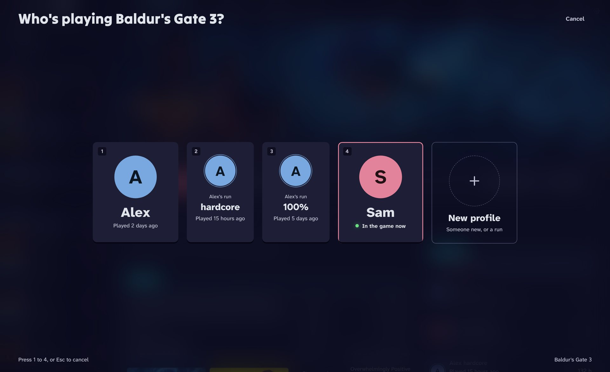

# Using Lootnest

The README is the short version. This page has the details: how a swap works, what profiles can't separate, adding a game by hand, where Lootnest keeps its data, Playnite, and installing without a window.

## How profiles work

1. You start a game from the Library, from Steam, or from a Lootnest desktop shortcut.
2. Lootnest asks who's playing.
3. It saves the files currently on the PC back to whoever they belong to, backs them up, and copies in the chosen player's files.
4. The game starts. Lootnest watches its process.
5. When the game closes, Lootnest saves the files to that player's profile.

For Steam's Play button, Lootnest sets the game's launch options to `"…\Lootnest.exe" --steam <app id> -- %command%`. It edits Steam's `localconfig.vdf` only while Steam is closed, changes only `LaunchOptions`, and keeps a backup. Options you already had are kept, and they're put back when you turn profiles off or uninstall Lootnest.

### Anti-cheats (FACEIT AC)

Some anti-cheats only let Steam start the game, so with FACEIT AC running, CS2 can't start through Lootnest's launch option. When that happens, Lootnest offers **Fix it and start the game**. It switches the game to **Let Steam start this game** (also in **Edit game**), takes itself out of the launch options, and starts the game for the chosen player through Steam.

From then on, start the game from Lootnest or from the **<game> (Lootnest)** desktop shortcut, and both ask who's playing. Steam's own Play button can't ask for these games, so if you use it anyway, a notification says whose settings are loaded.

### What profiles can't separate

Lootnest swaps files on your PC. Anything that belongs to the Steam account stays shared: achievements, playtime, friends, inventory and online ranks. So do settings a game keeps in the Windows registry or on its own servers. If everyone can have their own Steam account, that separates everything; profiles are for when you share one.

## Adding a game by hand

If the scan misses a game, use **Add game** and choose the Steam game or the .exe. Lootnest fills in the save locations it finds: with **Find save locations online** on, first the ones PCGamingWiki lists for the game, then folders named like it. Add any others yourself. [PCGamingWiki](https://www.pcgamingwiki.com) lists them for most PC games, in the "Game data" section. Paths can use `%APPDATA%`, `%LOCALAPPDATA%`, `{LOCALLOW}`, `{DOCUMENTS}`, `{SAVEDGAMES}`, `{STEAM}` and `{STEAMUSER}`.

Data lives in `%LOCALAPPDATA%\Lootnest`:
- `profiles\<player>\<game>`
- `backups\<game>\<date-time>`
- `covers`
- `avatars` and `banners` (pictures for player profiles)
- `shelf.json` and `activity.json` (each player's shelf and time played per day)
- `playnite.json` (the time played each import from Playnite brought in, so it's added once)
- `backup.json` (when the last backup to your folder was made)
- `sync.json` (what each player's cloud saves were at the last sync)
- `gamesaves.json` and `savedb.json.gz` (cloud saves of games outside Steam, and the save locations list)
- `safety-net\` and `safetynet.json` (copies of saves games keep inside their own folder, the last 5 per game)
- `config.json`
- `lootnest.log`

## Lootnest and Playnite

Lootnest works alongside [Playnite](https://playnite.link); it doesn't replace it. **Import from Playnite**, in Settings, Data and activity, brings in what Playnite knows about the games on this PC: time played and when last played, statuses (Playing, Beaten, Completed, Abandoned, Plan to Play, On Hold), favourites, ratings (Playnite's score as 1 to 5 stars), notes, and, if you choose, categories and tags as collections. The import is one way: Lootnest reads Playnite's library (`%APPDATA%\Playnite\library`, or the `library` folder of a portable Playnite) and never writes to it. Close Playnite first, because it keeps its library to itself while it's open.

Games are matched by their store and id (Steam, Epic, GOG), then by install folder, then by name. Playnite's games that aren't on this PC aren't added. Statuses, ratings, notes and time played go to the profile you choose. A status, rating or note only comes in for a game that has none; time played is added to what Lootnest counts, and importing again adds only what's new. Lootnest copies its own records to `backups\import` first, and **Undo** puts them back.

## Installing without a window

For scripts and package managers, run `start /wait Lootnest-Setup.exe --silent` in Command Prompt, or `Start-Process Lootnest-Setup.exe --silent -Wait` in PowerShell (`/S` and `/silent` work too). It installs for your Windows account with a Start menu shortcut; on an upgrade the desktop shortcut and Start with Windows stay as they are, and a first install adds neither. It doesn't open Lootnest afterwards. It exits with 0 when Lootnest is installed and 1 when it couldn't be, and then writes the reason to `Lootnest-Setup.log` in your `%TEMP%` folder.

## Updating and uninstalling

To update, use **Settings > Check for updates**. Your profiles, games and saves are kept. To uninstall, use Windows **Settings > Apps > Installed apps**.

## PlaySwap

Lootnest was called PlaySwap until version 1.3. Installing Lootnest over PlaySwap carries over players, games, profiles, backups and the Steam set-up.
